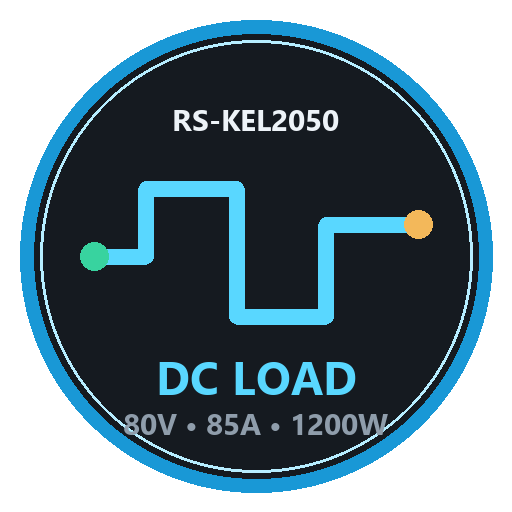
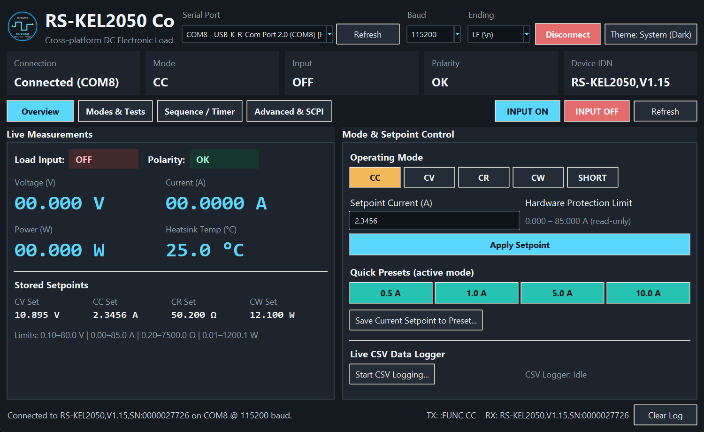
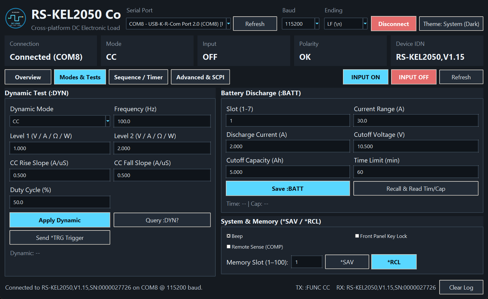
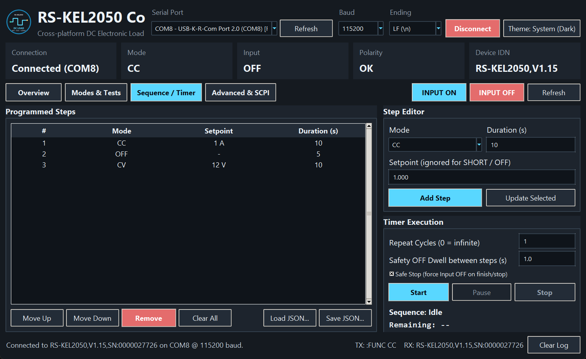
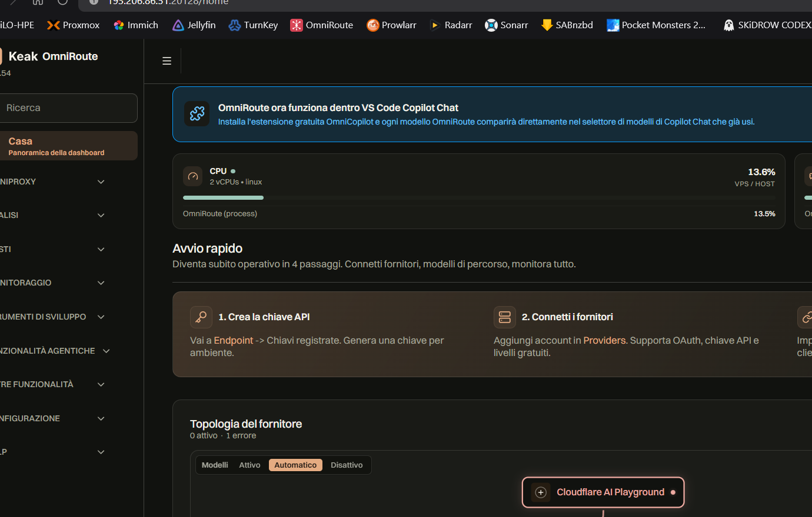

# RS PRO RS-KEL2050 - Python GUI Remote Controller

Interfaccia grafica open-source sviluppata in Python per il controllo remoto del carico elettronico programmabile DC **RS PRO RS-KEL2050** (serie Korad KEL2000) tramite collegamento USB/Seriale, compatibile nativamente con **macOS**, **Linux** e **Windows**.

<p align="center">
  
</p>

## Panoramica

Questo progetto fornisce una GUI desktop moderna progettata per semplificare il controllo remoto del carico elettronico programmabile **RS PRO RS-KEL2050** (fino a **80 V / 85 A / 1200 W**), offrendo un'alternativa open-source e multipiattaforma al software ufficiale Windows/LabVIEW.

È pensato per laboratori, banchi prova, maker e test su alimentatori o batterie, con supporto nativo per **macOS** (senza installare alcun driver aggiuntivo), **Linux** e **Windows**.

## Screenshot

### Overview

Vista principale con stato di connessione, modalità attiva, indicatori `INPUT ON/OFF` e polarità, misure live (`V`, `I`, `P`, `Temp`), setpoint memorizzati, preset rapidi personalizzabili e **Live CSV Data Logger**.

<p align="center">
  
</p>

### Modes & Tests

Sezione dedicata ai test dinamici (`:DYN`, `*TRG`), ai profili di scarica batterie (`:BATT`, `:BATT:TIM?`, `:BATT:CAP?`), alle memorie interne (`*SAV` / `*RCL` 1–100) e alle impostazioni di sistema (`BEEP`, `Key Lock`, `Remote Sense COMP`).

<p align="center">
  
</p>

### Sequence / Timer

Scheduler integrato per programmare sequenze temporizzate automatiche: ogni step può impostare `CC`, `CV`, `CR`, `CW`, `SHORT` oppure `OFF` (pausa) per una durata definita, con ripetizione ciclica, `Safe Stop` automatico ed export/import JSON.

<p align="center">
  
</p>

### Advanced & SCPI

Console SCPI manuale con log TX/RX dedicato ai comandi utente (il polling di monitoraggio in background rimane silenzioso per mantenere leggibile l'ultimo comando inviato).

<p align="center">
  
</p>

## Funzionalità principali

- Controllo remoto completo delle modalità **CC**, **CV**, **CR**, **CW** e **SHORT** (`CHOICE SHORT`) con gestione `INPUT ON/OFF`.
- Monitoraggio in tempo reale di tensione, corrente, potenza, temperatura del dissipatore e allarme **inversione di polarità**.
- Lettura e modifica dei limiti superiori (`:VOLT:UPP`, `:CURR:UPP`, `:RES:UPP`, `:POW:UPP`).
- **Preset rapidi** personalizzabili per ogni modalità (salvati in `~/.rs_kel2050_presets.json`).
- **Sequence / Timer** per automatizzare profili di carico a step temporizzati con salvataggio/caricamento JSON.
- **Live CSV Data Logger** per registrare nel tempo tutte le misure.
- Supporto a test **Dynamic (`:DYN`)**, **Battery Discharge (`:BATT`)** e memorie **`*SAV` / `*RCL`**.
- Interfaccia desktop Tkinter/ttk con tema **System / Light / Dark** automatico (`darkdetect`).
- Compatibilità multipiattaforma: **macOS**, **Linux** e **Windows**.

## Requisiti

### Software

- Python 3.10+
- `pyserial`
- `Pillow`
- `darkdetect`

### Hardware

- Carico elettronico programmabile **RS PRO RS-KEL2050** (o modello compatibile serie Korad KEL2000)
- Cavo USB collegato al computer

## Installazione da sorgente

1. Clonare la repository:

   ```bash
   git clone https://github.com/LucarVicti/rs-kel2050-gui-controller.git
   cd rs-kel2050-gui-controller
   ```

2. Creare un ambiente virtuale e installare le dipendenze:

   ```bash
   python3 -m venv .venv
   source .venv/bin/activate        # Su Windows: .venv\Scripts\activate
   pip install -r requirements.txt
   ```

3. Avviare l'applicazione:

   ```bash
   python3 rs_kel2050_gui.py
   ```

> Su macOS, se `tkinter` non fosse incluso nell'installazione Python di sistema, installare Python dal sito ufficiale `python.org` oppure via Homebrew (`brew install python-tk`).

## Releases & Build eseguibili

Nella cartella `release/` (e nella sezione [Releases](../../releases) del repository) sono disponibili i pacchetti pronti all'uso:

- `rs_kel2050_gui.exe` e `rs_kel2050_gui_windows-portable.zip` (Windows)
- `rs_kel2050_gui_linux.zip` (Linux x86_64)
- `rs_kel2050_gui_python.zip` (sorgenti Python multipiattaforma)
- **macOS (`rs_kel2050_gui_macos_arm64.zip` per Apple Silicon e `rs_kel2050_gui_macos_intel.zip` per Intel):** il repository include il workflow GitHub Actions (`.github/workflows/release.yml`) che compila automaticamente i pacchetti nativi per **Windows**, **macOS** (sia Apple Silicon `arm64` che Intel `x86_64`) e **Linux** al push di un tag `v*` (o manualmente dalla tab *Actions* di GitHub). Su macOS è inoltre disponibile lo script `./build_macos.sh`.

## Guida rapida

1. Collegare il carico elettronico al computer tramite USB.
2. Avviare il programma.
3. La porta seriale del dispositivo (`VID_0416&PID_5011`, es. `COM8` su Windows o `/dev/cu.usbmodem...` su macOS) viene selezionata automaticamente.
4. Verificare baud rate (`115200` di default) e line ending (`LF \n`).
5. Premere **Connect**.

## Note tecniche

- **macOS senza driver:** l'interfaccia USB del carico RS-KEL2050 (`SHENZHEN KORAD TECHNOLOGY Co., Ltd.`, `VID_0416`, `PID_5011`) utilizza la classe standard **USB CDC**. Su macOS (`AppleUSBCDC`) e Linux (`cdc_acm`) è riconosciuta nativamente dal kernel senza bisogno di driver di terze parti.
- **Linux:** potrebbe essere necessario aggiungere il proprio utente al gruppo `dialout` (`sudo usermod -aG dialout $USER`) per accedere alla porta `/dev/ttyACM*`.
- **Funzione SHORT:** imposta lo stato `CHOICE SHORT` sul carico; il cortocircuito controllato ai morsetti viene applicato solo quando si attiva `INPUT ON`.

## Test

```bash
python3 -m unittest discover -s tests -t . -v
```

## Disclaimer

Questo progetto non è ufficialmente affiliato, sponsorizzato o supportato da RS Components o Korad Technology.

## Licenza

Questo progetto è distribuito sotto licenza **GNU General Public License v3.0**.
Vedere il file `LICENSE` per il testo completo.

